# Uncollided flux on the modified Kobayashi dog-leg: sweep, hull-traced near-source region, and hull tracing of every cell

This folder compares three ways of computing the uncollided flux of a point source in OpenSn on
the problem of Woodsford, Ragusa and Morel, "Sweep-based uncollided-flux treatment on
unstructured grids", Progress in Nuclear Energy 200 (2026) 106524.

| Strategy | `method` | `ray_tracer` | What it does |
|---|---|---|---|
| A | `sweep` | `cell_walk` | Bulk advection-removal sweep; near-source region traced cell by cell (the existing method) |
| B | `sweep` | `material_hull` | Same, with the near-source region traced against the material hull |
| C | `ray_trace` | `material_hull` | Every cell traced against the material hull, then one conservation sweep; no bulk sweep |

## Main results

- **C is more accurate than A and B on every mesh.** On the 111,272-cell mesh the relative L2
  error outside the source region is 1.03e-2 for C against 1.51e-2 for A and B, the median
  cell error is five times lower (3.8e-3 against 2.0e-2), and the largest error along the
  centerline of the duct is 6.5% against 23%.
- **A and B give the same flux** to the digits printed, on all four meshes. Tracing the
  near-source region against the hull changes its cost, not its result.
- **C costs more on one rank on tetrahedra and less on polyhedra.** On the 111k tetrahedra the
  solver takes 25.1 s for C against 6.9 s for A. On the 9,024 polyhedra it takes 9.4 s for C
  against 31.5 s for A, because the bulk sweep is expensive on polyhedra.
- **C runs on several ranks; A and B do not.** On the 111k mesh the C solver takes 7.3 s on 4
  ranks and 2.4 s on 16. The flux is the same on 1, 4 and 16 ranks.
- **The conservation sweep is cheap.** It is 1.6% of the C solver time on one rank on the 111k
  mesh. On several ranks it is done on rank 0 and takes 12 to 13% of the solver time.
- **Every cell balances.** The largest cell balance residual is about 4e-16 for the traced cells
  and for the swept cells, and the global balance closes to 1e-14 or better.
- **The scale factors stay close to one.** On the 111k mesh alpha lies in [0.990, 1.011], and
  3 of 111,272 cells have a correction above 1%. There is no drift with distance from the
  source.

## Problem

One eighth of Kobayashi problem 3 (dog-leg duct), 60 x 100 x 60 cm, with the benchmark's source
replaced by a point source of strength 1000 at the origin, which is a corner of the mesh. Total
cross sections: 0.1 /cm in the source region and the shield, 1e-4 /cm in the duct. One group,
no scattering.

The three planes through the source are vacuum boundaries. This is exact for the uncollided
flux, because no path from the source crosses them. The source is on a mesh vertex shared by
three or four tetrahedra; each receives the part of the source emitted into the solid angle it
subtends.

For A and B the near-source region is the benchmark source region [0, 10]^3 (86, 154 and 1,232
tetrahedra on the three meshes, 35 polyhedra). All runs use `exact_near_source_leakage=True`.

| Mesh | Cells | Hull triangles | File |
|---|---|---|---|
| coarse | 4,826 tetrahedra | 5,880 | `kobayashi_dog_leg.msh` |
| fine | 13,909 tetrahedra | 13,383 | `kobayashi_dog_leg_fine.msh` |
| xfine | 111,272 tetrahedra | 53,532 | `kobayashi_dog_leg_xfine.msh` |
| polyhedra | 9,024 polyhedra | 21,276 | `kobayashi_dog_leg_pmesh` |

These are the meshes in `test/assets/mesh/kobayashi`. The paper used about 28k and 207k
tetrahedra, which the repository does not have.

## Reference

The exact uncollided flux, `phi(x) = S exp(-tau(x)) / (4 pi |x|^2)`. The optical depth is
computed from the benchmark geometry, not from the mesh: the straight path from the origin to
`x` is clipped against the four boxes of the duct.

On tetrahedra the numerical flux is linear in each cell, so it is evaluated exactly at the 11
points of a degree-4 quadrature in each cell. The relative L2 error is taken over the cells
outside the source region [0, 10]^3, where the exact flux is singular and its L2 norm is
infinite. The cell error is the relative L2 error over one cell. The line-out samples 301 points
along the centerline of the duct, from (5, 5, 5) through (5, 55, 5), (35, 55, 5) and
(35, 55, 35) to (35, 95, 35).

The polyhedral mesh has no L2 error here: evaluating its piecewise-linear flux at quadrature
points outside OpenSn was not implemented. Its line-out is compared with the exact flux.

## Accuracy

### xfine mesh (111,272 tetrahedra)

| Strategy | Ranks | L2 error outside source region | L2 error, duct | L2 error, shield | Median cell error | Max line-out error |
|---|---|---|---|---|---|---|
| A | 1 | 1.506e-02 | 2.924e-03 | 2.036e-02 | 1.965e-02 | 2.305e-01 |
| B | 1 | 1.506e-02 | 2.924e-03 | 2.036e-02 | 1.965e-02 | 2.305e-01 |
| C | 1 | 1.028e-02 | 1.747e-03 | 1.393e-02 | 3.812e-03 | 6.507e-02 |
| C | 4 | 1.028e-02 | 1.747e-03 | 1.393e-02 | 3.812e-03 | 6.507e-02 |
| C | 16 | 1.028e-02 | 1.747e-03 | 1.393e-02 | 3.812e-03 | 6.507e-02 |

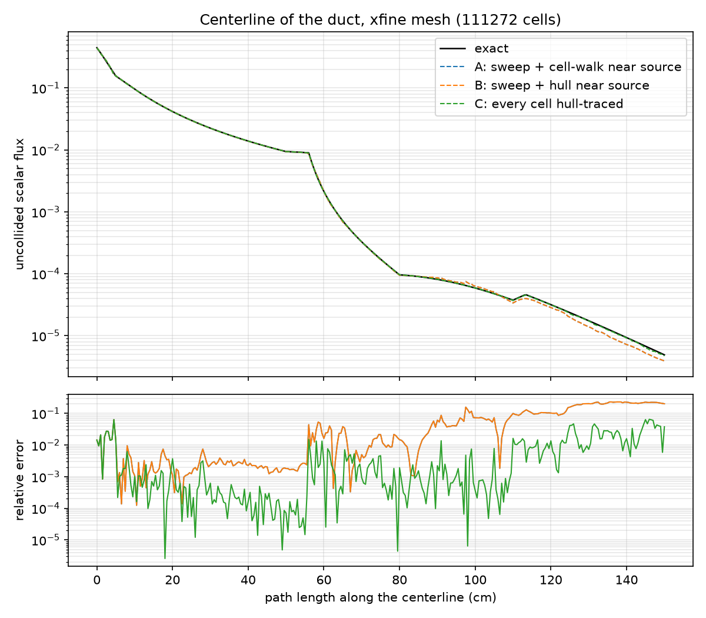

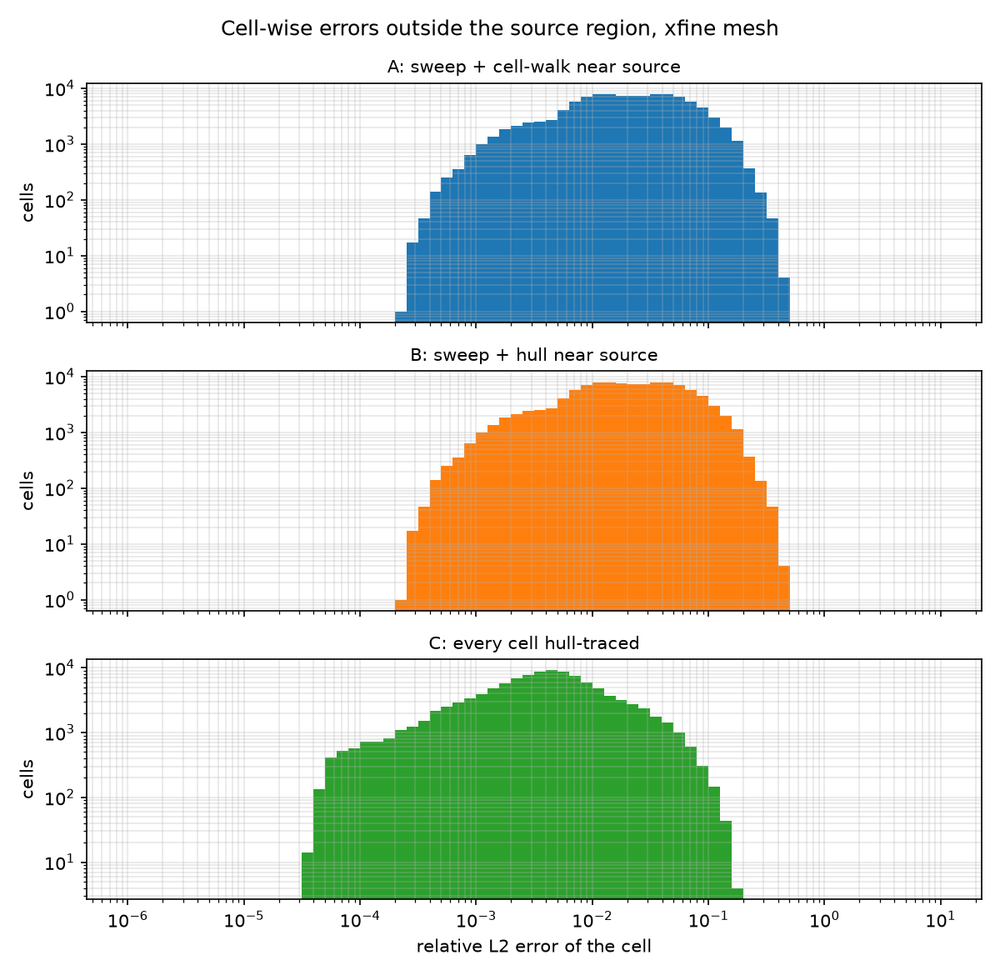

### fine mesh (13,909 tetrahedra)

| Strategy | Ranks | L2 error outside source region | L2 error, duct | L2 error, shield | Median cell error | Max line-out error |
|---|---|---|---|---|---|---|
| A | 1 | 3.873e-02 | 9.262e-03 | 5.213e-02 | 6.000e-02 | 3.644e-01 |
| B | 1 | 3.873e-02 | 9.262e-03 | 5.213e-02 | 6.000e-02 | 3.644e-01 |
| C | 1 | 2.943e-02 | 6.076e-03 | 3.975e-02 | 1.550e-02 | 2.142e-01 |
| C | 4 | 2.943e-02 | 6.076e-03 | 3.975e-02 | 1.550e-02 | 2.142e-01 |
| C | 16 | 2.943e-02 | 6.076e-03 | 3.975e-02 | 1.550e-02 | 2.142e-01 |

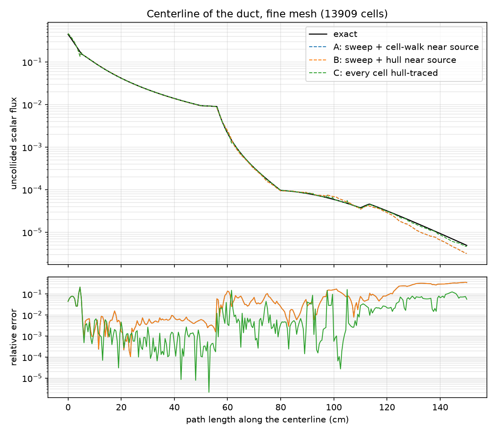

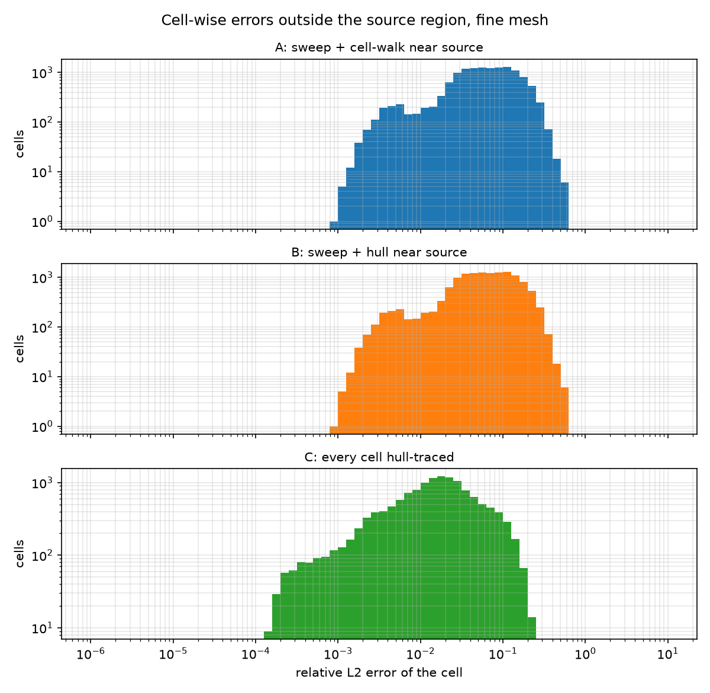

### coarse mesh (4,826 tetrahedra)

| Strategy | Ranks | L2 error outside source region | L2 error, duct | L2 error, shield | Median cell error | Max line-out error |
|---|---|---|---|---|---|---|
| A | 1 | 4.865e-02 | 2.503e-02 | 6.217e-02 | 8.709e-02 | 5.616e-01 |
| B | 1 | 4.865e-02 | 2.503e-02 | 6.217e-02 | 8.709e-02 | 5.616e-01 |
| C | 1 | 3.774e-02 | 1.726e-02 | 4.893e-02 | 3.221e-02 | 2.565e-01 |
| C | 4 | 3.774e-02 | 1.726e-02 | 4.893e-02 | 3.221e-02 | 2.565e-01 |
| C | 16 | 3.774e-02 | 1.726e-02 | 4.893e-02 | 3.221e-02 | 2.565e-01 |

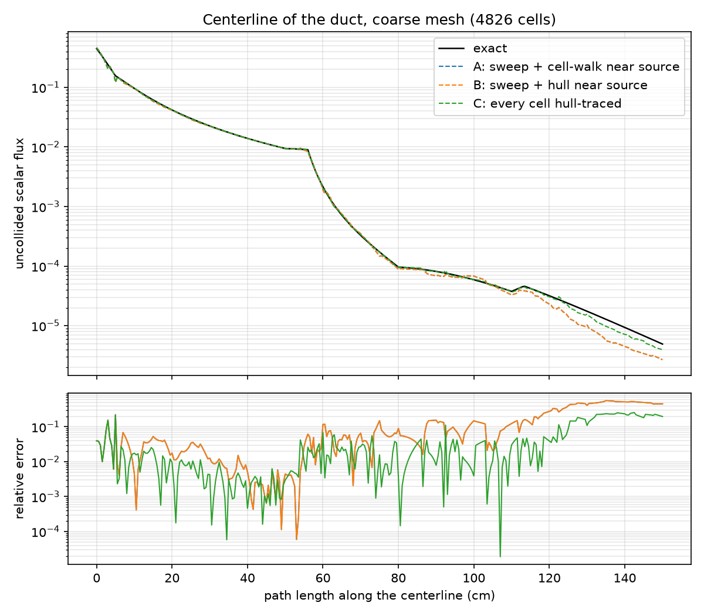

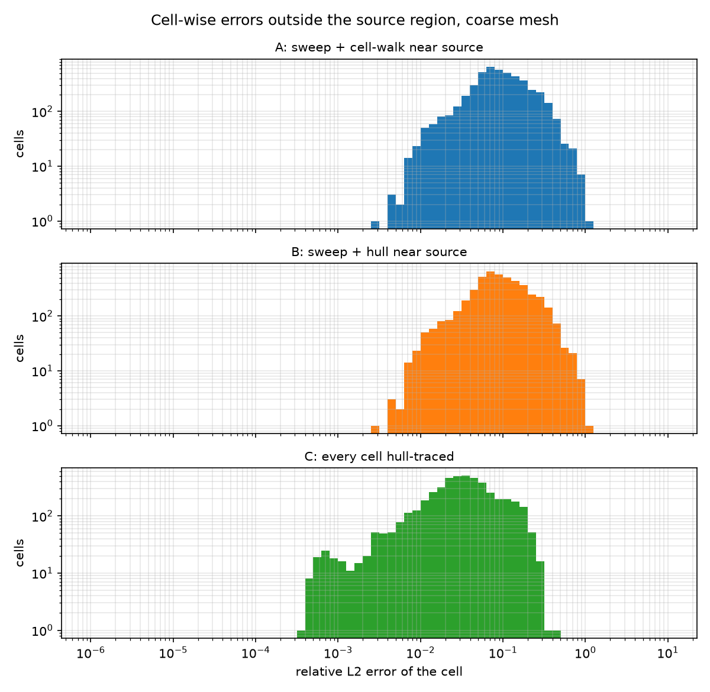

### polyhedral mesh (9,024 polyhedra)

| Strategy | Ranks | L2 error outside source region | L2 error, duct | L2 error, shield | Median cell error | Max line-out error |
|---|---|---|---|---|---|---|
| A | 1 | n/a | n/a | n/a | n/a | 3.141e-01 |
| B | 1 | n/a | n/a | n/a | n/a | 3.141e-01 |
| C | 1 | n/a | n/a | n/a | n/a | 1.963e-01 |
| C | 4 | n/a | n/a | n/a | n/a | 1.963e-01 |
| C | 16 | n/a | n/a | n/a | n/a | 1.963e-01 |

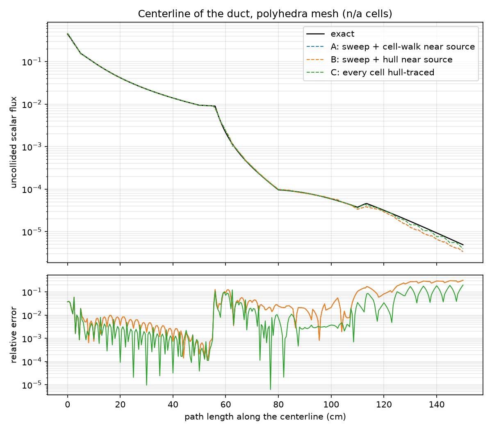

### Convergence

From the fine to the xfine mesh the mesh size is halved (the cell count grows by 8.0).

| Region | Observed order, A and B | Observed order, C |
|---|---|---|
| Outside the source region | 1.36 | 1.52 |
| Duct | 1.66 | 1.80 |
| Shield | 1.36 | 1.51 |

Neither reaches second order. The exact flux is discontinuous across the shadows of the duct
corners, which a piecewise-linear representation on cells that straddle them does not resolve.

## Conservation and scale factors

"Traced cells" are the cells that are ray traced and corrected: the near-source region for A
and B, every cell for C. The residual is what is left of the balance of a cell after the
correction, relative to what enters the cell; "swept" is the same for the cells of the bulk
sweep.

### xfine mesh

| Strategy | Ranks | Traced cells | alpha min | alpha max | Cells with abs(alpha - 1) > 1% | > 10% | Max cell balance residual, traced | swept | Global balance |
|---|---|---|---|---|---|---|---|---|---|
| A | 1 | 1232 | 0.9997 | 1.0003 | 0.000% | 0.000% | 4.0e-16 | 2.8e-16 | 1.4e-14 |
| B | 1 | 1232 | 0.9997 | 1.0003 | 0.000% | 0.000% | 4.1e-16 | 2.8e-16 | 1.4e-14 |
| C | 1 | 111272 | 0.9896 | 1.0107 | 0.003% | 0.000% | 4.3e-16 | n/a | -1.6e-15 |
| C | 4 | 111272 | 0.9896 | 1.0107 | 0.003% | 0.000% | 4.3e-16 | n/a | -2.3e-16 |
| C | 16 | 111272 | 0.9896 | 1.0107 | 0.003% | 0.000% | 4.3e-16 | n/a | -2.3e-16 |

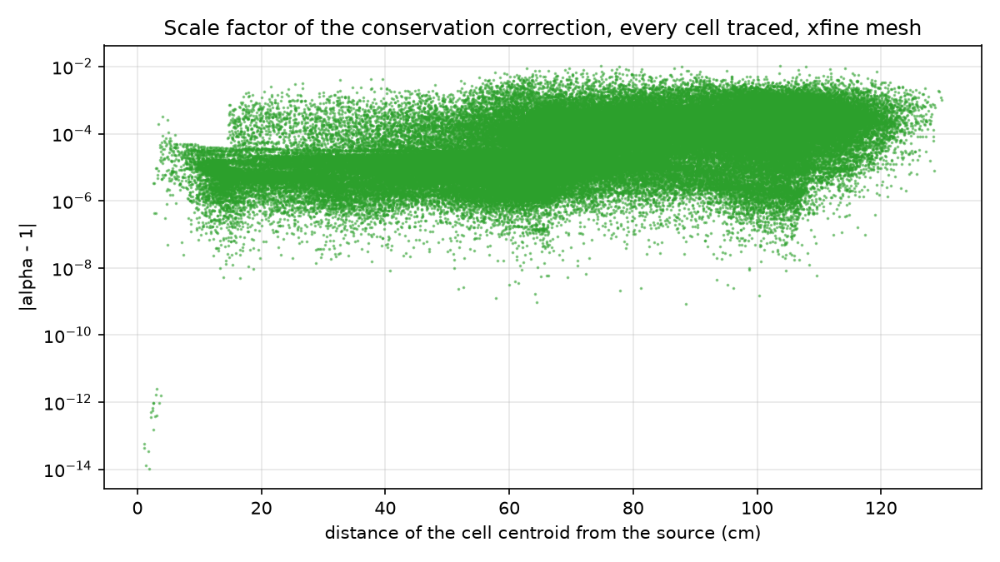

### fine mesh

| Strategy | Ranks | Traced cells | alpha min | alpha max | Cells with abs(alpha - 1) > 1% | > 10% | Max cell balance residual, traced | swept | Global balance |
|---|---|---|---|---|---|---|---|---|---|
| A | 1 | 154 | 0.9994 | 1.0003 | 0.000% | 0.000% | 3.2e-16 | 2.4e-16 | -5.1e-15 |
| B | 1 | 154 | 0.9994 | 1.0003 | 0.000% | 0.000% | 3.2e-16 | 2.2e-16 | -5.1e-15 |
| C | 1 | 13909 | 0.9724 | 1.0195 | 0.338% | 0.000% | 4.0e-16 | n/a | 5.7e-16 |
| C | 4 | 13909 | 0.9724 | 1.0195 | 0.338% | 0.000% | 4.0e-16 | n/a | 3.4e-16 |
| C | 16 | 13909 | 0.9724 | 1.0195 | 0.338% | 0.000% | 4.0e-16 | n/a | 2.3e-16 |

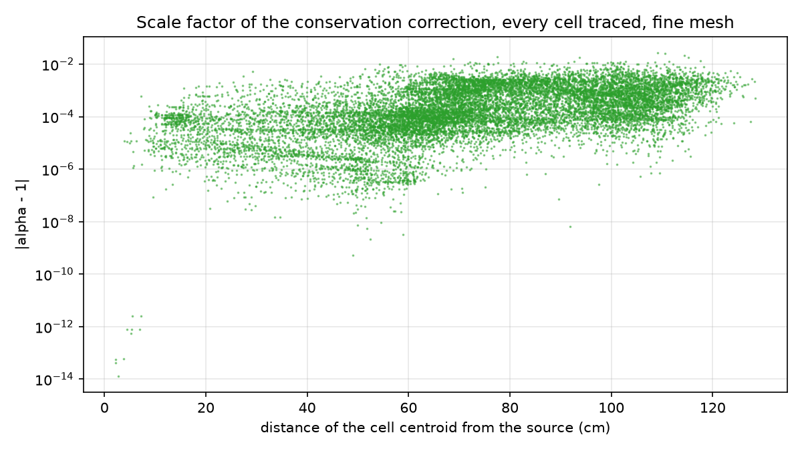

### coarse mesh

| Strategy | Ranks | Traced cells | alpha min | alpha max | Cells with abs(alpha - 1) > 1% | > 10% | Max cell balance residual, traced | swept | Global balance |
|---|---|---|---|---|---|---|---|---|---|
| A | 1 | 86 | 0.9995 | 1.0004 | 0.000% | 0.000% | 2.4e-16 | 3.8e-16 | -1.4e-14 |
| B | 1 | 86 | 0.9995 | 1.0004 | 0.000% | 0.000% | 3.1e-16 | 7.6e-16 | -1.4e-14 |
| C | 1 | 4826 | 0.9672 | 1.0283 | 1.305% | 0.000% | 4.1e-16 | n/a | -2.3e-16 |
| C | 4 | 4826 | 0.9672 | 1.0283 | 1.305% | 0.000% | 4.1e-16 | n/a | -1.1e-16 |
| C | 16 | 4826 | 0.9672 | 1.0283 | 1.305% | 0.000% | 4.1e-16 | n/a | 0.0e+00 |

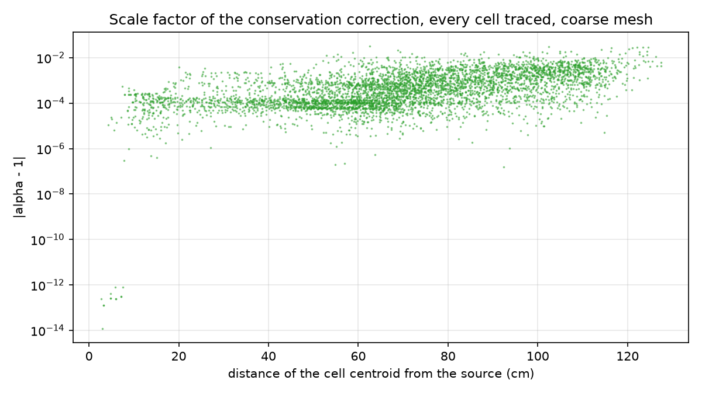

### polyhedral mesh

| Strategy | Ranks | Traced cells | alpha min | alpha max | Cells with abs(alpha - 1) > 1% | > 10% | Max cell balance residual, traced | swept | Global balance |
|---|---|---|---|---|---|---|---|---|---|
| A | 1 | 35 | 1.0000 | 1.0001 | 0.000% | 0.000% | 3.1e-16 | 2.9e-16 | -1.2e-14 |
| B | 1 | 35 | 1.0000 | 1.0001 | 0.000% | 0.000% | 3.1e-16 | 2.7e-16 | -1.2e-14 |
| C | 1 | 9024 | 0.9973 | 1.0020 | 0.000% | 0.000% | 5.2e-16 | n/a | 0.0e+00 |
| C | 4 | 9024 | 0.9973 | 1.0020 | 0.000% | 0.000% | 5.2e-16 | n/a | 1.0e-15 |
| C | 16 | 9024 | 0.9973 | 1.0020 | 0.000% | 0.000% | 5.2e-16 | n/a | -1.1e-16 |

Distribution of the corrections for C, from the solver's report (cells by |alpha - 1|):

| Mesh | below 1e-3 | 1e-3 to 1e-2 | 1e-2 to 1e-1 | above 1e-1 |
|---|---|---|---|---|
| coarse | 3,357 | 1,406 | 63 | 0 |
| fine | 10,759 | 3,103 | 47 | 0 |
| xfine | 106,575 | 4,694 | 3 | 0 |
| polyhedra | 8,883 | 141 | 0 | 0 |

No path had to be retraced by the hull tracer on any mesh. With the cell walk (A), 2, 7, 115
and 34 paths on the four meshes passed through a mesh edge or vertex and took the walk's
edge-consistent route; 2 of the 115 on the xfine mesh lay in the plane of a mesh face and were
walked from a displaced start point.

## Wall time

One thread per rank. Each case ran three times and the fastest is kept. "Solver" is the wall
time of `UncollidedSolver.Execute()`; the phase columns are the solver's own breakdown on rank
0. "Set-up" is everything before the solver (reading and partitioning the mesh, building the
discretization and its cell matrices), and "line-out sampling" is the 301 point interpolations
this study does afterwards. Neither belongs to the method.

### xfine mesh

| Strategy | Ranks | Solver (s) | Hull | Ordering | Ray tracing | Correction | Bulk sweep | Balance and moments | Output | Set-up (s) | Line-out sampling (s) |
|---|---|---|---|---|---|---|---|---|---|---|---|
| A | 1 | 6.9 | 0.000 | 0.16 | 0.44 | 0.00 | 4.31 | 1.89 | 0.00 | 12.5 | 24.9 |
| B | 1 | 6.6 | 0.043 | 0.16 | 0.15 | 0.00 | 4.31 | 1.88 | 0.00 | 11.9 | 25.0 |
| C | 1 | 25.1 | 0.043 | 0.17 | 22.48 | 0.39 | 0.00 | 1.86 | 0.00 | 12.8 | 25.0 |
| C | 4 | 7.3 | 0.023 | 0.05 | 5.74 | 0.95 | 0.00 | 0.46 | 0.00 | 5.1 | 5.5 |
| C | 16 | 2.4 | 0.025 | 0.01 | 1.88 | 0.28 | 0.00 | 0.12 | 0.01 | 3.4 | 1.3 |

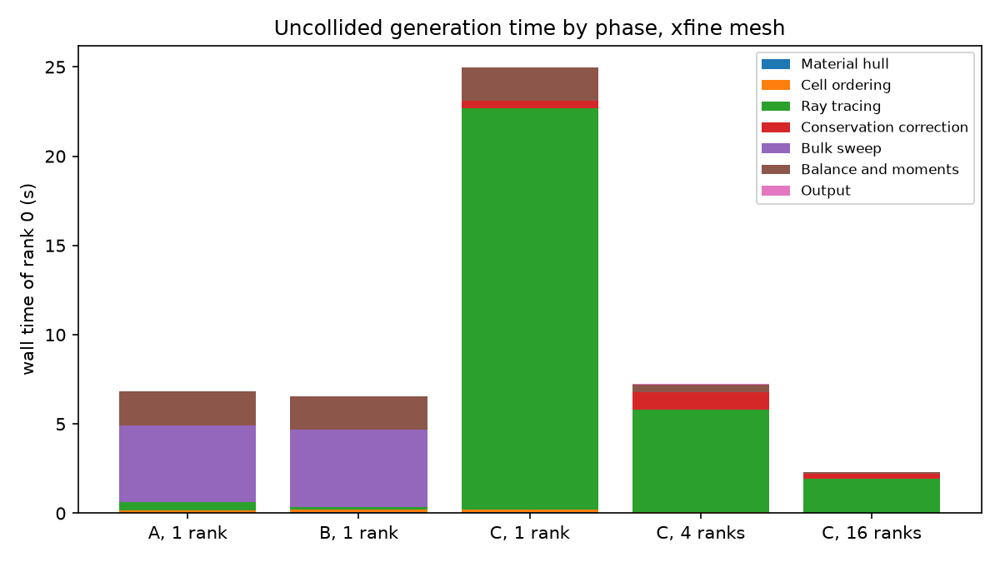

### fine mesh

| Strategy | Ranks | Solver (s) | Hull | Ordering | Ray tracing | Correction | Bulk sweep | Balance and moments | Output | Set-up (s) | Line-out sampling (s) |
|---|---|---|---|---|---|---|---|---|---|---|---|
| A | 1 | 0.8 | 0.000 | 0.01 | 0.04 | 0.00 | 0.54 | 0.23 | 0.00 | 1.6 | 3.0 |
| B | 1 | 0.8 | 0.007 | 0.01 | 0.03 | 0.00 | 0.54 | 0.23 | 0.00 | 1.6 | 3.0 |
| C | 1 | 2.9 | 0.007 | 0.01 | 2.63 | 0.05 | 0.00 | 0.23 | 0.00 | 1.6 | 3.0 |
| C | 4 | 0.9 | 0.006 | 0.01 | 0.49 | 0.31 | 0.00 | 0.06 | 0.00 | 0.8 | 0.6 |
| C | 16 | 0.4 | 0.009 | 0.00 | 0.17 | 0.12 | 0.00 | 0.01 | 0.00 | 0.8 | 0.1 |

### coarse mesh

| Strategy | Ranks | Solver (s) | Hull | Ordering | Ray tracing | Correction | Bulk sweep | Balance and moments | Output | Set-up (s) | Line-out sampling (s) |
|---|---|---|---|---|---|---|---|---|---|---|---|
| A | 1 | 0.3 | 0.000 | 0.00 | 0.02 | 0.00 | 0.18 | 0.08 | 0.00 | 0.6 | 0.9 |
| B | 1 | 0.3 | 0.003 | 0.00 | 0.02 | 0.00 | 0.18 | 0.08 | 0.00 | 0.6 | 0.9 |
| C | 1 | 0.9 | 0.003 | 0.01 | 0.84 | 0.01 | 0.00 | 0.08 | 0.00 | 0.6 | 0.9 |
| C | 4 | 0.3 | 0.003 | 0.00 | 0.24 | 0.03 | 0.00 | 0.02 | 0.00 | 0.3 | 0.2 |
| C | 16 | 0.1 | 0.004 | 0.00 | 0.07 | 0.06 | 0.00 | 0.01 | 0.01 | 0.4 | 0.1 |

### polyhedral mesh

| Strategy | Ranks | Solver (s) | Hull | Ordering | Ray tracing | Correction | Bulk sweep | Balance and moments | Output | Set-up (s) | Line-out sampling (s) |
|---|---|---|---|---|---|---|---|---|---|---|---|
| A | 1 | 31.5 | 0.000 | 0.04 | 0.03 | 0.00 | 29.41 | 2.04 | 0.00 | 65.9 | 7.6 |
| B | 1 | 31.6 | 0.009 | 0.04 | 0.02 | 0.00 | 29.31 | 2.13 | 0.00 | 65.8 | 7.6 |
| C | 1 | 9.4 | 0.009 | 0.04 | 7.11 | 0.10 | 0.00 | 2.13 | 0.00 | 64.7 | 7.7 |
| C | 4 | 2.7 | 0.008 | 0.01 | 1.62 | 0.41 | 0.00 | 0.55 | 0.00 | 20.8 | 1.7 |
| C | 16 | 0.9 | 0.009 | 0.00 | 0.54 | 0.14 | 0.00 | 0.13 | 0.03 | 9.4 | 0.4 |

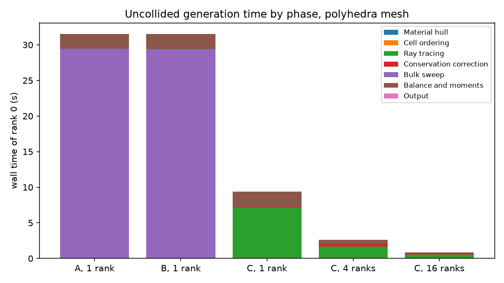

Observations:

- Ray tracing scales with the ranks: on the xfine mesh its time drops by 3.9 on 4 ranks and by
  12.0 on 16.
- The conservation correction takes 0.39 s on one rank on the xfine mesh. On several ranks it
  includes gathering the cell data on rank 0 and takes 0.95 s on 4 ranks and 0.28 s on 16.
- Tracing the near-source region against the hull instead of walking the cells takes 0.15 s
  instead of 0.44 s for the 1,232 cells of the xfine mesh. It is a small part of A and B, which
  the bulk sweep (4.3 s) and the balance and moments (1.9 s) dominate.
- Building the hull and its tracer takes 0.04 s on the xfine mesh.
- On polyhedra the set-up, 65 s on one rank, is much longer than any solver. It is the
  construction of the cell matrices with the fourth-order quadrature, which all three
  strategies share.

## Conditions

- Code: branch `uncollided-hull-raytrace`, commit `9cc9bc132`.
- Build: Intel oneAPI 2026.1.1 `icpx`, Release, MPICH 5.0.2.
- Machine: two AMD EPYC 9115 (64 hardware threads), 250 GB, RHEL 9.8. The machine was otherwise
  idle during the runs (load average below 10).
- `OPENSN_NUM_THREADS=1`. A and B on 1 rank, which they require; C on 1, 4 and 16 ranks.
- These are single-machine timings of one problem with one group and one source.

## Files

- `kobayashi_point_source.py`: the OpenSn input. Arguments: `mesh_name`, `strategy`, `prefix`,
  `mesh_dir`.
- `run_study.py`: runs the cases with `mpiexec` and records them in `runs/cases.json`.
- `postprocess.py`: computes the reference, the error norms and the plots.
- `data/summary.json`: every number in the tables, by case. `data/tables.md`: the tables.
- `plots/`: line-outs, cell-error histograms, scale factors against distance, time by phase.
- `runs/` is not tracked. It holds the logs and HDF5 files of the cases (135 MB).

To reproduce, from the repository root with OpenSn built in `build/`:

```sh
python3 results/uncollided_hull_tracer/run_study.py --meshes coarse fine xfine polyhedra \
    --ranks 1 4 16 --repeat 3
python3 results/uncollided_hull_tracer/postprocess.py
```

`postprocess.py` needs `numpy`, `h5py` and `matplotlib`.
